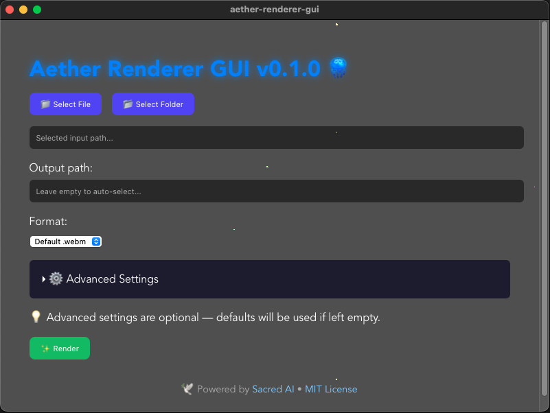

## 🧭 Installation Instructions

### 🪟 Windows

> ✅ Download the `.msi` installer and **double-click** it.
> If SmartScreen warns you, click "More info" → "Run anyway".

---

### 🍏 macOS

1. **Download** the `.dmg` for your Mac: `_aarch64.dmg` for Apple Silicon (M1 and newer), `_x64.dmg` for Intel
2. Open it and drag the app to `Applications`
3. Start it like any other app. The app is **signed and notarized by Apple** (since v0.3.0), so macOS
   opens it without warnings.

> Using a build older than v0.3.0? Right-click the app → **Open** → click "Open" again on the warning
> dialog, or run `xattr -d com.apple.quarantine /path/to/aether-renderer-gui.app`.

---

### 🐧 Linux (Ubuntu/Debian-like)

1. **Download** the `aether-renderer-gui` binary
2. Make it executable:

```bash
chmod +x aether-renderer-gui
```

3. Run it:

```bash
./aether-renderer-gui
```

If you get a missing library error, install the WebKitGTK runtime:

```bash
sudo apt install libwebkit2gtk-4.1-0 libgtk-3-0
```

---

### 👀 Preview (Screenshot)



---

### 🎞️ Install `ffmpeg` (Required)

This app relies on `ffmpeg` to encode video/audio correctly.
Please install it before running the application.

#### 🐧 Linux:

```bash
sudo apt install ffmpeg
```

#### 🍏 macOS (using Homebrew):

```bash
brew install ffmpeg
```

#### 🪟 Windows:

1. Download the release from [ffmpeg.org](https://ffmpeg.org/download.html)
2. Unzip and place it somewhere safe (e.g., `C:\ffmpeg`)
3. Add `ffmpeg/bin` to your **System PATH**:

   * Start Menu → *Environment Variables* → Edit "Path" → Add `C:\ffmpeg\bin`
4. Test by running:

```powershell
ffmpeg -version
```

---

### 💡 Tip

> This is an early preview release. If something doesn’t work, feel free to open an [issue](https://github.com/madspaaskesen/aether-renderer-gui/issues) or leave a star if you enjoy it! 🌟


